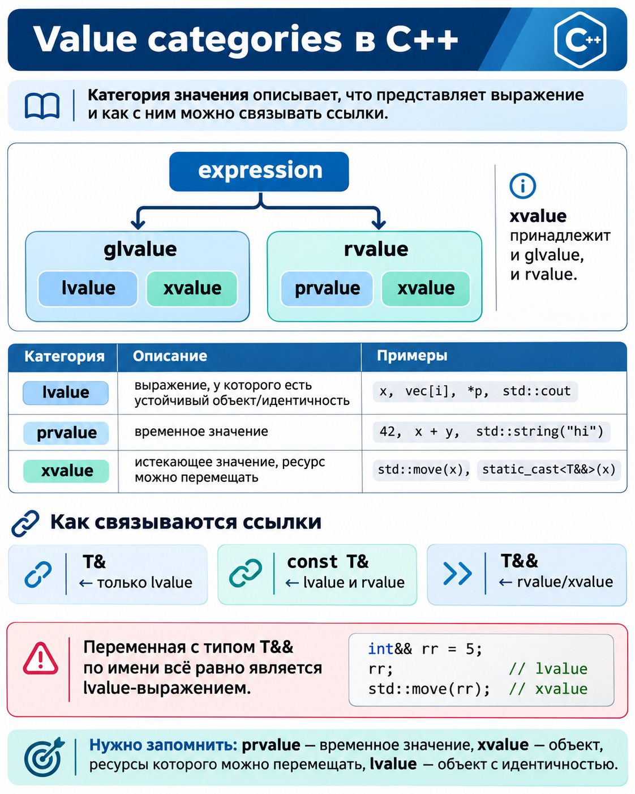
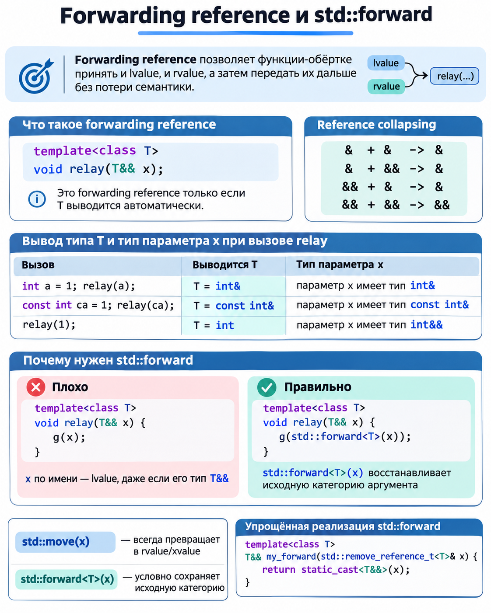
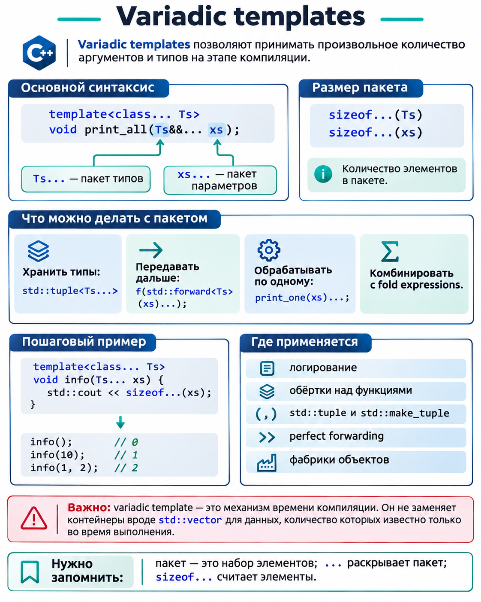
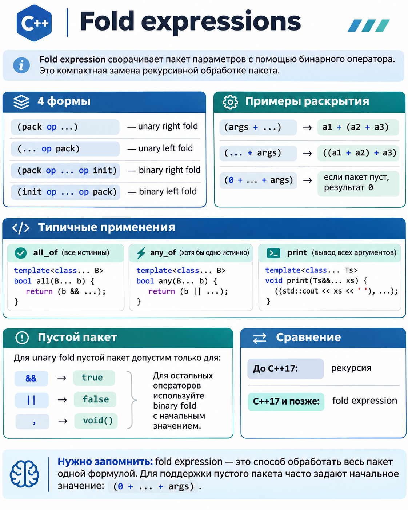

# От сортировки результатов к универсальному рейтингу

Мы разрабатываем небольшую программу для организаторов соревнований. Начинаем с обычной сортировки результатов и заканчиваем библиотечной функцией, которая принимает только сравнимые и печатаемые типы. По дороге выясним, зачем нужны функторы, bind, лямбды, forwarding references, variadic templates, SFINAE и concepts.


Если хочется сначала разобраться в языке на маленьких независимых задачах, откройте [пошаговый конспект](theory/README.md).

## 0. Задача и запуск

У нас четыре участника:

| Имя | Баллы |
|---|---:|
| Anna | 82 |
| Boris | 95 |
| Daria | 95 |
| Ivan | 71 |

Хотим получить рейтинг: Boris, Daria, Anna, Ivan. Если баллы совпадают, сохраняем исходный порядок. Номер строки — просто порядковый номер, а не спортивное разделённое место. Потом понадобится выводить список по имени, формировать строки отчёта с разным количеством колонок и ранжировать не только участников, но и числа, строки, другие типы результатов.

```bash
# 1. Настраиваем проект (CMake создаёт файлы сборки в build/).
cmake -S . -B build -DCMAKE_BUILD_TYPE=Debug

# 2. Собираем все доступные этапы
cmake --build build --parallel

# 3. Запускаем доступные этапы по очереди.
cmake --build build --target run

# Можно собрать и запустить только один этап.
cmake --build build --target 01a_ordinary_function
./build/01a_ordinary_function

# Собираем отдельно примеры теории или запускаем их все.
cmake --build build --target theory
cmake --build build --target run-theory
```

Требуются CMake 3.20 или новее и GCC либо Clang с поддержкой C++20. `-S .` указывает каталог исходников, `-B build` — отдельный каталог сборки. `--target` выбирает конкретную цель из `CMakeLists.txt`. Конфигурацию выполняем один раз, далее достаточно пересобирать нужную цель.

Этапы 1–5 используют C++17, этап 6 — C++20. Для выбора другого компилятора создайте отдельный каталог: `cmake -S . -B build-clang -DCMAKE_CXX_COMPILER=clang++ -DCMAKE_BUILD_TYPE=Debug`, затем `cmake --build build-clang`. Компилятор фиксируется при первой конфигурации каталога сборки. В `examples/` по мере развития проекта появятся небольшие самостоятельные программы для каждого промежуточного решения, в `include/` — общий код. В `theory/examples/` с первого коммита доступны все независимые примеры конспекта, в том числе по темам следующих занятий. Начиная с этапа 4 появится каталог `negative/` с намеренно некорректными программами; они исключены из обычной сборки, их диагностику проверяет CTest.

Проверить все программы после сборки: `ctest --test-dir build --output-on-failure`. Начиная с этапа 4, проверки с меткой `negative` используют GCC/Clang и считают ожидаемый отказ компиляции успешным результатом; сообщения сохраняются в `build/*.log`.


Каждый `.cpp` в `examples/` — отдельный исполняемый пример с `main`. Буквы в именах задают порядок внутри этапа: `01a`, `01b`, `01c` и т. д. В каждом подразделе ниже есть ссылка на исходник и команда `run-...`, которая собирает и запускает только этот пример. Повторение нескольких строк (данные, вывод, `main`) намеренное: можно изучать файл без перехода по цепочке других исходников. Общий тип данных и реализация готового рейтинга остаются в `include/`.

## 1. Один алгоритм, разные правила сортировки

Откройте [`include/result.hpp`](include/result.hpp) и [`examples/01a_ordinary_function.cpp`](examples/01a_ordinary_function.cpp).

### 1.1. Начинаем с обычных объектов и функций

Пример: [`examples/01a_ordinary_function.cpp`](examples/01a_ordinary_function.cpp) — запуск: `cmake --build build --target run-01a_ordinary_function`.

Для начала нужен тип, описывающий одну строку:

```cpp
struct Result {
    std::string name;
    int points;
};
```

`sample_results()` возвращает вектор из четырёх таких объектов. В заголовке также есть оператор вывода:

```cpp
inline std::ostream& operator<<(std::ostream& out,
                                const Result& value) {
    return out << value.name << " (" << value.points << ')';
}
```

Зачем перегружать `<<`? Мы хотим, чтобы `std::cout << row` работало так же, как `std::cout << 42`. Слева — поток, справа — объект. `const Result&` позволяет читать его без копии и запрещает менять поля через эту ссылку. Возвращаем ссылку на тот же поток, чтобы можно было продолжить вывод: `std::cout << row << '\n'`. Поток не копируется. `inline` здесь нужен для корректного определения обычной функции в заголовке, подключаемом несколькими единицами трансляции, а не для обязательного встраивания вызова.

Сначала достаточно обычной функции сравнения (промежуточный вариант):

```cpp
bool higher_score(const Result& a, const Result& b) {
    return a.points > b.points;
}

std::stable_sort(rows.begin(), rows.end(), higher_score);
```

Что получает `stable_sort`? Первый и последний итераторы задают диапазон `[begin, end)`; третий аргумент задаёт правило. Алгоритм сам решает, какие пары сравнивать. Он вызывает переданное правило как `compare(a, b)`. Если результат true, a должно стоять раньше b.

Почему `>` вместо `>=`? При сравнении Boris и Daria оба имеют 95 баллов. Ни один не должен быть строго раньше другого по баллам. С `>=` оба направления вернули бы true; это нарушает контракт сортировки. Компаратор обязан задавать строгое слабое упорядочение (в частности, отношение должно быть иррефлексивным и транзитивным, а эквивалентность — транзитивной). `stable_sort` сохраняет порядок эквивалентных элементов; `sort` такой гарантии не даёт.

Обычная функция хороша, пока правило одно. Для обратного направления можно добавить `lower_score` и выбирать одну из двух функций. При двух фиксированных правилах это вполне разумно.

### 1.2. Новое требование: правило должно хранить настройки

Пример: [`examples/01b_three_arguments.cpp`](examples/01b_three_arguments.cpp) — запуск: `cmake --build build --target run-01b_three_arguments`.

Теперь пользователь задаёт направление сортировки. Попробуем добавить третий аргумент:

```cpp
bool compare_points(const Result& a, const Result& b,
                    bool descending) {
    return descending ? a.points > b.points : a.points < b.points;
}
```

`descending` определяет, какое сравнение использовать. Условный оператор `?:` выбирает одну из двух веток.

Но `std::stable_sort(..., compare_points)` не подходит: алгоритм вызовет функцию с двумя аргументами, а ей нужны три. Мы не можем добавить направление в интерфейс стандартного алгоритма.

Глобальная переменная могла бы хранить направление, но два независимых правила оказались бы привязаны к одному изменяемому состоянию. Вместо этого сохраним настройку в объекте, как сохраняем поля любого класса. Осталось научить этот объект реагировать на запись `compare(a,b)`.

### 1.3. Функтор: состояние и действие в одном объекте

Пример: [`examples/01c_functor.cpp`](examples/01c_functor.cpp) — запуск: `cmake --build build --target run-01c_functor`.

```cpp
struct ByPoints {
    bool descending;

    bool operator()(const Result& a, const Result& b) const {
        return descending ? a.points > b.points : a.points < b.points;
    }
};
```

Разбираем новую часть. `operator()` — имя специальной функции-члена, которая вызывается при записи `object(...)`. Первые скобки — часть имени оператора; вторые содержат параметры функции. Последнее `const` относится к объекту ByPoints: внутри этой функции нельзя менять его обычное поле `descending`.

```cpp
ByPoints compare{true};
Result anna{"Anna", 82};
Result boris{"Boris", 95};

bool answer = compare(boris, anna);
// То же самое: compare.operator()(boris, anna)
```

`ByPoints{true}` — инициализация поля объекта. `answer` равен true, потому что 95 > 82. Другой экземпляр `ByPoints{false}` имеет своё значение поля и работает в обратную сторону. Объект, который можно вызвать, обычно называют функтором (function object).

Теперь строка из `01c_functor.cpp` понятна:

```cpp
std::stable_sort(rows.begin(), rows.end(), ByPoints{descending});
```

Алгоритм получает готовый объект с настройкой. Он не знает о поле `descending` и не должен знать: он только вызывает объект с двумя элементами.

**Что выиграли?** Состояние не глобальное, можно независимо создавать правила с разными настройками. Недостаток: ради маленькой операции приходится объявлять отдельный класс. Такой класс оправдан, когда правило сложное или используется в нескольких местах.

### 1.4. Зачем std::bind, если функтор уже работает?

Пример: [`examples/01d_bind.cpp`](examples/01d_bind.cpp) — запуск: `cmake --build build --target run-01d_bind`.

Представим, что трёхаргументная `compare_points` уже есть в библиотеке. Переписывать её нельзя. Нужен адаптер: при создании сохраняет направление, а при вызове принимает только пару объектов.

Можно написать класс, чей `operator()` вызывает исходную функцию с сохранённым третьим аргументом. `std::bind` автоматизирует создание такого объекта. В `01d_bind.cpp` используем обычную трёхаргументную функцию из предыдущего примера без изменений; функтор для этого не нужен.

```cpp
using namespace std::placeholders;
auto bound = std::bind(compare_points, _1, _2, descending);
```

`std::bind` из `<functional>` здесь не выполняет сравнение. Он создаёт вызываемый объект. Первый аргумент — функция, которую вызовем позже. `_1` означает «возьми первый аргумент будущего вызова», `_2` — второй. `descending` — уже известное значение, оно сохраняется в адаптере (обычно как decayed-копия).

Если `descending == true`, то вызов `bound(boris, anna)` означает `compare_points(boris, anna, true)`. Можно было бы поменять `_1` и `_2` местами, но здесь это изменило бы порядок сортировки.

Зачем `auto`? Тип результата bind задаётся библиотекой и не имеет удобного переносимого имени. Нам нужен сам объект, а не его точное имя типа. `using namespace std::placeholders` позволяет писать `_1` вместо `std::placeholders::_1` (в примере область ограничена `main`).

Плюсы bind: адаптация существующих функций, фиксация параметров и перестановка аргументов. Минусы: приходится мысленно сопоставлять плейсхолдеры с параметрами; перегруженное имя функции иногда требует уточнения типа; для хранения ссылки вместо копии нужен `std::ref` и контроль времени жизни.

### 1.5. Лямбда: выразим тот же адаптер непосредственно

Пример: [`examples/01e_lambda.cpp`](examples/01e_lambda.cpp) — запуск: `cmake --build build --target run-01e_lambda`.
Пример: [`examples/01f_lambda_by_name.cpp`](examples/01f_lambda_by_name.cpp) — запуск: `cmake --build build --target run-01f_lambda_by_name`.

```cpp
auto lambda = [descending](const Result& a, const Result& b) {
    return compare_points(a, b, descending);
};
```

Прочитаем слева направо:

- `[descending]` — захват: сохранить копию настройки в создаваемом объекте. Это не аргумент будущего вызова.
- `(const Result& a, const Result& b)` — два аргумента будущего вызова, их передаст сортировка.
- `{ return ...; }` — тело вызова. Компилятор выводит возвращаемый тип bool.

Лямбда создаёт объект уникального безымянного класса с `operator()`. По умолчанию вызов const; `mutable` позволил бы менять захваченную копию. `[&descending]` вместо копии означал бы обращение к исходной переменной, которая должна ещё существовать при вызове. Нам это не нужно: настройку достаточно зафиксировать.

В примере переиспользуем уже написанную функцию `compare_points`; можно также записать сравнение прямо в теле лямбды. В отличие от bind, видно, какие два аргумента принимает адаптер и куда они идут.

Лямбды и `std::bind` появились в C++11; похожие bind-адаптеры существовали ранее в STL и Boost. Лямбды вытеснили большинство локальных адаптеров за счёт читаемости, не потому что всегда быстрее. Именованные функторы не исчезли: лямбда сама является вызываемым объектом, а отдельный класс полезен для переиспользования.

Запуск:

```bash
cmake --build build --target run-01a_ordinary_function
cmake --build build --target run-01b_three_arguments
cmake --build build --target run-01c_functor
cmake --build build --target run-01d_bind
cmake --build build --target run-01e_lambda
cmake --build build --target run-01f_lambda_by_name
```

Обычная функция, функтор, bind и лямбда дают одинаковый рейтинг: Boris (95), Daria (95), Anna (82), Ivan (71). `01b` выводит `true`, затем `false`: непосредственно сравниваем пару с двумя настройками. `01f` сортирует по имени через лямбду с пустым захватом `[]`. Каждый файл начинает с тех же исходных данных; пересобирать один большой main не нужно.

**Переход дальше:** пока мы везде пишем `std::stable_sort` напрямую. Если захотим скрыть этот вызов в собственном интерфейсе, понадобится научиться передавать вызываемые объекты дальше.

## 2. Обёртка для сортировки: forwarding reference и std::forward

Код: отдельные файлы `02a`–`02f`; ссылки и команды запуска приведены в каждом подразделе. Дополнительные примеры: [перегрузки по ссылкам](theory/examples/05_reference_overloads.cpp), [forwarding](theory/examples/07_forwarding.cpp).

### 2.1. Сначала самая простая обёртка

Пример: [`examples/02a_rank_by_value.cpp`](examples/02a_rank_by_value.cpp) — запуск: `cmake --build build --target run-02a_rank_by_value`.

```cpp
template<class Compare>
void rank_by(std::vector<Result>& rows, Compare compare) {
    std::stable_sort(rows.begin(), rows.end(), compare);
}
```

`Compare` — тип компаратора, который выводится из второго аргумента. Первый аргумент — неконстантная ссылка: сортировка переставляет элементы исходного вектора. Передача compare по значению создаёт собственный локальный объект. Это вполне хороший интерфейс, когда мы хотим владеть копией правила.

Но поставим дополнительное требование к обёртке: она должна передавать компаратор дальше так, как его передал пользователь. Если передан существующий объект — не превращать его в временный, а если временный — не делать его именованным lvalue в следующем вызове. Это важно для универсальных адаптеров, которые могут вызывать функции с различными перегрузками.

Мы используем сортировку как пример обёртки; `stable_sort` принимает компаратор по значению и может копировать его внутри. Чтобы увидеть проблему без вмешательства алгоритма, введём маленький эксперимент.

### 2.2. Почему следующая функция может выбрать другую перегрузку?

Пример: [`examples/02b_reference_overloads.cpp`](examples/02b_reference_overloads.cpp) — запуск: `cmake --build build --target run-02b_reference_overloads`.

В `02b_reference_overloads.cpp` есть три функции:

```cpp
void receive(ByPoints&) { std::cout << "lvalue\n"; }
void receive(const ByPoints&) { std::cout << "const lvalue\n"; }
void receive(ByPoints&&) { std::cout << "rvalue\n"; }
```

У них одинаковые имена, но разные типы параметров. `ByPoints&` связывается с изменяемым lvalue, `const ByPoints&` — с константным lvalue и также с временными, `ByPoints&&` — с подходящим rvalue. Вызов с временным объектом предпочитает rvalue-ссылку константной lvalue-ссылке.

```cpp
ByPoints comparator;
const ByPoints const_comparator;
receive(comparator);       // lvalue
receive(const_comparator); // const lvalue
receive(ByPoints{});       // rvalue
```

Почему категории вообще нужны? Представьте вместо receive функцию сохранения строки: для существующего объекта она может копировать содержимое, для временного — перемещать. Категория помогает разрешению перегрузок выбрать нужный интерфейс. Наши три receive ничего не копируют и не перемещают: они лишь показывают выбор.

Тип — что за данные представляет выражение; категория — как выражение обозначает объект или значение. `comparator` обозначает существующий объект с идентичностью, это lvalue. `ByPoints{}` — prvalue, при связывании со ссылкой материализуется временный объект. `std::move(comparator)` — xvalue: обозначает тот же объект, но позволяет связываться с rvalue-ссылкой. Prvalue и xvalue относятся к rvalue.

Если обёртка принимает `const Compare&`, она примет все три исходных аргумента, но внутри `receive(compare)` всегда получит const lvalue. Если принимает `Compare&`, временный объект передать нельзя. Если принимает по значению, receive увидит lvalue локальной копии. Можно написать отдельные перегрузки, но для нескольких независимо передаваемых аргументов число вариантов быстро растёт.

### 2.3. Зачем здесь T&&? Сначала научимся принимать аргумент

Пример: [`examples/02c_reference_deduction.cpp`](examples/02c_reference_deduction.cpp) — запуск: `cmake --build build --target run-02c_reference_deduction`.

```cpp
template<class Compare>
void relay(Compare&& compare) {
    // Пока не вызываем receive.
}
```

Обычно `ByPoints&&` — rvalue-ссылка. Но здесь `Compare` выводится компилятором и находится непосредственно в `Compare&&`. Язык предусматривает специальное правило: для lvalue выводится тип со ссылкой, для rvalue — тип без ссылки (с нужными cv-квалификаторами). Поэтому такая форма называется forwarding reference (также universal reference).

Проследим один вызов `relay(comparator)`:

1. Аргумент — lvalue типа ByPoints.
2. Из специального правила `Compare = ByPoints&`.
3. Подставляем в объявление параметра `Compare&&`: получается комбинация `ByPoints& &&`.
4. Правило схлопывания превращает её в `ByPoints&`. Параметр связан с исходным объектом, копии нет.

Для `relay(ByPoints{})` шаг 2 даёт `Compare = ByPoints`. Тогда параметр имеет обычный тип `ByPoints&&`.

| Вызов | Выведенный Compare | Тип параметра |
|---|---|---|
| `relay(comparator)` | `ByPoints&` | `ByPoints&` |
| `relay(const_comparator)` | `const ByPoints&` | `const ByPoints&` |
| `relay(ByPoints{})` | `ByPoints` | `ByPoints&&` |
| `relay(std::move(comparator))` | `ByPoints` | `ByPoints&&` |

Ссылки на ссылки не существуют как отдельные типы, но могут появиться комбинации при подстановке через шаблон или псевдоним. Схлопывание: `& + & → &`, `& + && → &`, `&& + & → &`, `&& + && → &&`. Если хотя бы одна ссылка lvalue — результат lvalue.

Почему не всякий `&&` такой? `void f(ByPoints&&)` не выводит тип. В `template<class T> void f(const T&&)` добавлен const, поэтому правило forwarding reference не действует. В `template<class T> struct Box { void f(T&&); };` T уже выбран при создании Box; вызов f его не выводит.

### 2.4. Мы приняли аргумент, но не сохранили категорию его выражения

Пример: [`examples/02d_bad_relay.cpp`](examples/02d_bad_relay.cpp) — запуск: `cmake --build build --target run-02d_bad_relay`.

```cpp
template<class Compare>
void bad_relay(Compare&& compare) {
    receive(compare);
}
```

Что произойдёт с `bad_relay(ByPoints{})`? Тип параметра — `ByPoints&&`. Однако внутри функции `compare` — имя переменной, обозначающее объект. Такое выражение является lvalue. Поэтому `receive(compare)` выбирает `receive(ByPoints&)`.

Почему язык устроен так? Владелец rvalue-ссылки может многократно читать объект по имени; каждый доступ не должен автоматически означать готовность отдать его ресурсы. Чтобы снова использовать выражение как rvalue, требуется явное преобразование.

Если написать `receive(std::move(compare))`, временный аргумент будет передан как rvalue, но так же будет передан и обычный именованный аргумент. Мы потеряем различие в другую сторону.

Нам уже известен исходный выведенный Compare. Он хранит нужную информацию: ссылка для lvalue, тип без ссылки для rvalue. Осталось применить её к выражению.

### 2.5. std::forward: восстановить нужную категорию

Пример: [`examples/02e_forward_relay.cpp`](examples/02e_forward_relay.cpp) — запуск: `cmake --build build --target run-02e_forward_relay`.

```cpp
template<class Compare>
void relay(Compare&& compare) {
    receive(std::forward<Compare>(compare));
}
```

`std::forward` из `<utility>` концептуально делает `static_cast<Compare&&>(compare)`. Рассмотрим две подстановки:

| Compare | Тип преобразования после схлопывания | Выражение результата |
|---|---|---|
| `ByPoints&` | `ByPoints&` | lvalue |
| `const ByPoints&` | `const ByPoints&` | const lvalue |
| `ByPoints` | `ByPoints&&` | xvalue (rvalue) |

Почему у forward явно пишем `<Compare>`? По одному именованному `compare` уже нельзя определить категорию исходного аргумента. Надо передать исходный выведенный тип. Упрощённая реализация для нашего случая:

```cpp
template<class T>
T&& my_forward(std::remove_reference_t<T>& x) noexcept {
    return static_cast<T&&>(x);
}
```

`remove_reference_t<T>` удаляет ссылку из типа (не удаляет const), `&` позволяет принять именованное выражение x. `T&&` в возвращаемом типе снова схлопывается. `noexcept` обещает отсутствие исключений. Стандартный forward также имеет перегрузку для rvalue; здесь только модель нужного случая.

Forward не перемещает ресурсы сам. Он возвращает ссылку с нужной категорией; дальнейшая функция решает, копировать или перемещать. Изначальный prvalue при этом передаётся как xvalue материализованного объекта, а не заново как prvalue.

**Объяснение std::forward "на пальцах"**

Представим функцию-посредника, которая должна передать вещь другому человеку, не меняя условий её передачи

1. Бытовой пример: передача посылки
Представим, что ты работаешь в пункте передачи посылок. К тебе приходят два человека:

- Первый приносит свою личную коробку и просит показать её получателю, но не забирать содержимое.

- Второй приносит коробку, которая ему больше не нужна, и разрешает получателю забрать её содержимое.

Ты — посредник. Твоя задача не решать судьбу коробки, а передать дальше исходное разрешение.

В терминах C++:
- lvalue — объект, который вызывающая сторона передаёт как существующий, именованный объект.

- rvalue — выражение, обозначающее временный объект или объект, ресурсы которого можно использовать для перемещения.

`std::forward` позволяет посреднику сохранить это различие.


### 2.6. Возвращаемся к rank_by

Пример: [`examples/02f_rank_by_forward.cpp`](examples/02f_rank_by_forward.cpp) — запуск: `cmake --build build --target run-02f_rank_by_forward`.

```cpp
template<class Compare>
void rank_by(std::vector<Result>& rows, Compare&& compare) {
    std::stable_sort(rows.begin(), rows.end(),
                     std::forward<Compare>(compare));
}
```

Теперь можно передать именованный компаратор, временный функтор или лямбду. Forward сохраняет семантику передачи на границе нашей обёртки. Он не отменяет требования `stable_sort` к компаратору и не гарантирует отсутствие внутренних копий.

В отдельном файле `02c_reference_deduction.cpp` есть `check_lvalue` и `check_rvalue`. Они используют `static_assert` (проверка при компиляции) и `std::is_same_v<A,B>` (true, если типы совпадают). `decltype(value)` для непомещённого в скобки имени возвращает объявленный тип; `decltype((value))` анализирует категорию выражения. Поэтому даже в `check_rvalue` второе выражение даёт `ByPoints&`.

```bash
cmake --build build --target run-02d_bad_relay
cmake --build build --target run-02e_forward_relay
cmake --build build --target run-02f_rank_by_forward
```

`02d` выводит `lvalue` для временного объекта. `02e` выводит три строки: `lvalue`, `const lvalue`, `rvalue`. `02f` выводит рейтинг, не сообщения о перегрузках.

**Выбор подхода:** для чтения используйте `const T&`, для собственных объектов — передачу по значению, для явного потребления ресурсов — move/rvalue-интерфейс, для прозрачных обёрток — forwarding. Не храните ссылку на временный объект после окончания его времени жизни и не используйте аргумент повторно после потенциального перемещения.

Мы научились принимать и передавать один аргумент произвольного типа. Теперь обобщим это на несколько аргументов.

## 3. Отчёт с произвольным числом полей

Код: [`examples/03g_report_row.cpp`](examples/03g_report_row.cpp), [`include/report_row.hpp`](include/report_row.hpp).

### 3.1. Почему простой функции перестаёт хватать?

Пример: [`examples/03a_fixed_row.cpp`](examples/03a_fixed_row.cpp) — запуск: `cmake --build build --target run-03a_fixed_row`.

Для таблицы можно написать `print_row(out, place, name, points)` с фиксированными типами. Но строка заголовка состоит из трёх строк, строка итога — из текста, числа и дополнительных полей, а заключительная строка — из одного текста. Хотим один интерфейс:

```cpp
print_row(std::cout, "Place", "Name", "Points");
print_row(std::cout, 1, "Anna", 82);
print_row(std::cout, "Total", 4, "participants", true);
print_row(std::cout, "End of report");
```

Можно написать четыре перегрузки. Но тогда повторяется логика разделителей, а для нового числа колонок потребуется ещё одна функция. `vector<string>` удобен, когда данные уже текстовые и количество полей определяется при выполнении, но здесь пришлось бы заранее преобразовывать числа и пользовательские объекты в строки. Мы уже умеем печатать их через `<<`; хочется воспользоваться этим.

### 3.2. Пакет типов и пакет параметров

Пример: [`examples/03b_pack_size.cpp`](examples/03b_pack_size.cpp) — запуск: `cmake --build build --target run-03b_pack_size`.

```cpp
template<class... Fields>
void print_row(std::ostream& out, Fields&&... fields);
```

`class... Fields` — не один тип, а пакет типов. `Fields&&... fields` — пакет параметров функции. Каждый имеет собственный тип и выводится независимо по правилам предыдущей главы. `out` — один обычный параметр, не входит в пакет.

Пусть `place` — переменная `std::size_t`, `row` — `const Result&`. При вызове `print_row(out, place, row.name, row.points)`:

| Параметр пакета | Выведенный тип в Fields | Тип параметра |
|---|---|---|
| place | `std::size_t&` | `std::size_t&` |
| row.name | `const std::string&` | `const std::string&` |
| row.points | `const int&` | `const int&` |

Пакет может содержать и один элемент, и ноль. `sizeof...(Fields)` считает типы, `sizeof...(fields)` — параметры; результат одинаков. Это не размер в байтах. В `03b_pack_size.cpp` функция `field_count` выводит 3 и 0 для двух вызовов.

### 3.3. Как передать пакет дальше?

Пример: [`examples/03c_pack_expansion.cpp`](examples/03c_pack_expansion.cpp) — запуск: `cmake --build build --target run-03c_pack_expansion`.

С одним аргументом пишем `std::forward<T>(x)`. С пакетом нужно применить то же действие к каждой соответствующей паре типа и аргумента:

```cpp
detail::print_row_impl(out, std::forward<Fields>(fields)...);
```

`...` после выражения раскрывает его в список аргументов. При трёх полях концептуально получится:

```cpp
detail::print_row_impl(out,
    std::forward<F1>(f1),
    std::forward<F2>(f2),
    std::forward<F3>(f3));
```

`F1`, `f1` и т. д. — условные обозначения, не настоящие имена, которые можно вставить в проект. Это не цикл: число аргументов известно при компиляции. Пакет — не контейнер, поэтому нельзя написать `for (auto field : fields)`.

### 3.4. Сначала обработаем пакет без fold

Пример: [`examples/03d_recursive_print.cpp`](examples/03d_recursive_print.cpp) — запуск: `cmake --build build --target run-03d_recursive_print`.

В C++11/14 можно было делать это рекурсивно:

```cpp
void emit_all() {} // Базовый случай: печатать больше нечего.

template<class First, class... Rest>
void emit_all(First&& first, Rest&&... rest) {
    std::cout << std::forward<First>(first) << '\n';
    emit_all(std::forward<Rest>(rest)...);
}
```

Для `emit_all(1, "Anna", 82)` первая инстанциация выводит 1 и вызывает функцию с двумя оставшимися аргументами. Затем выводится Anna, потом 82, затем вызывается пустая перегрузка. Если не объявить базовый случай, в конце не найдётся подходящая функция. [Запускаемый пример](theory/examples/09_recursive_print.cpp).

Рекурсия работает. Но для простой одинаковой обработки всех полей приходится разделять первый и оставшиеся аргументы и определять остановку. В C++17 появился более прямой способ — fold expression.

### 3.5. Сначала разбираемся с обычным оператором запятая

- Пример: [`examples/03e_comma_operator.cpp`](examples/03e_comma_operator.cpp) 

— Запуск: `cmake --build build --target run-03e_comma_operator`.

- Пример: [`examples/03f_comma_fold.cpp`](examples/03f_comma_fold.cpp) 

— Запуск: `cmake --build build --target run-03f_comma_fold`.

```cpp
int x = 0;
int result = (x = 10, x = 20, x + 5);
```

Встроенная запятая вычисляет левое выражение, отбрасывает его результат, затем вычисляет правое. Здесь x становится 10, затем 20; result равен 25. Нам нужна не арифметика, а последовательность действий.

Если `emit` — функция, печатающая одно поле и возвращающая void, то `(emit(1), emit("Anna"), emit(82))` выполнит три действия слева направо. Как сформировать такую последовательность для произвольного пакета?

```cpp
(emit(fields), ...);
```

Это унарная правая свёртка по запятой: при трёх аргументах она раскрывается в `(emit(f1), (emit(f2), emit(f3)))`. Унарная означает, что имеется только выражение с пакетом, без дополнительного начального операнда. Правая — вложенность скобок справа. Порядок вычисления зависит от оператора, не от слова «правая»: встроенная запятая гарантирует выполнение слева направо.

### 3.6. Реализуем одну строку отчёта целиком

Пример: [`examples/03g_report_row.cpp`](examples/03g_report_row.cpp) — запуск: `cmake --build build --target run-03g_report_row`.

В `report_row.hpp`:

```cpp
template<class... Fields>
void print_row_impl(std::ostream& out, Fields&&... fields) {
    bool first = true;
    [[maybe_unused]] auto emit = [&](auto&& field) {
        if (!first) {
            out << " | ";
        }
        out << std::forward<decltype(field)>(field);
        first = false;
    };
    (emit(std::forward<Fields>(fields)), ...);
    out << '\n';
}
```

Зачем локальная лямбда? Мы хотим один раз описать операцию над полем: перед ним нужен разделитель, если это не первое поле, затем печать поля и изменение состояния. `first` — состояние одной строки. Захват `[&]` позволяет использовать `out` и `first` по ссылке; лямбда вызывается сразу внутри функции, а не сохраняется после выхода. Поэтому ссылки остаются действительными.

`auto&& field` — выводимый параметр обобщённой лямбды (generic lambda). Её `operator()` шаблонный: каждое поле может иметь свой тип. Почему `decltype(field)`? Мы не объявляли отдельное имя T для типа параметра лямбды. Decltype непомещённого в скобки имени даёт объявленный тип параметра со ссылкой, что и нужно для forward. Не пишем `decltype((field))`: именованный field — lvalue, тогда исходное rvalue было бы потеряно.

Сначала внешний forward сохраняет категорию при вызове emit, затем внутренний — при вызове `operator<<`. Для обычных чисел это не существенно, но пользовательский оператор может различать lvalue и rvalue. Позднее ограничение проверяет именно такую операцию.

`[[maybe_unused]]` подавляет предупреждение о неиспользуемой лямбде в инстанциации с пустым пакетом. Это атрибут C++17, не часть алгоритма. `emit` возвращает void, поэтому запятая точно встроенная, а не перегруженный оператор пользовательского типа.

Для `print_row(out, 1, "Anna", 82)` получим:

| Шаг | first до | Действие |
|---|---|---|
| 1 | true | Выводим 1, first становится false |
| 2 | false | Выводим ` \| Anna` |
| 3 | false | Выводим ` \| 82` |
| после свёртки | false | Выводим перевод строки |

### 3.7. А если в пакете нет полей?

Пример: [`examples/03g_report_row.cpp`](examples/03g_report_row.cpp) — запуск: `cmake --build build --target run-03g_report_row`.

`print_row(out)` — разрешённый вызов: иногда нужна пустая строка. При нуле элементов свёртка по запятой заменяется выражением `void()`: нет значения и нет действий. Затем выполняется `out << '\n'`.

Важно: не всякая унарная свёртка допускает пустой пакет. Для `&&` результат true (ни одно условие не нарушено), для `||` false (ни одно условие не выполнено), для запятой `void()`. Для `+` без начального значения — ошибка, поскольку нет операнда. Для суммы можно явно указать начальное значение: `(0 + ... + args)`, при пустом пакете получится 0. Это бинарная левая свёртка.

Разберите [подробный конспект о пустых свёртках](theory/EMPTY_FOLDS.md) и запустите `cmake --build build --target run-theory-25_empty_folds`.

Все четыре формы: `(E op ...)` и `(... op E)` — унарные правая и левая; `(E op ... op I)` и `(I op ... op E)` — бинарные правая и левая (E содержит пакет, I — начальное выражение). Скобки обязательны. Пример различия: `(args - ...)` для 10, 3, 2 даёт `10 - (3 - 2) = 9`, а `(... - args)` — `(10 - 3) - 2 = 5`.

```bash
cmake --build build --target 03g_report_row
./build/03g_report_row
```

```text
Place | Name | Points
1 | Anna | 82
2 | Boris | 95
3 | Daria | 95
4 | Ivan | 71
Total | 4 | participants | 1
End of report
```

После последней строки есть ещё пустая строка. `true` печатается как 1, потому что мы не включали `std::boolalpha`. Пока участники в исходном порядке: мы разрабатывали форматирование независимо от сортировки.

**Выбор подхода:** variadic templates удобны для числа и типов полей, известных при компиляции. Для динамического контейнера однородных данных лучше цикл. Fold уменьшает вспомогательный код, но не гарантирует ускорения или меньшего бинарника. Следующая проблема — шаблон пока принимает даже поля, которые вывести нельзя.

## 4. Универсальный рейтинг: что должны уметь элементы?

Ревью того, что мы разобрали к настоящему моменту, можно посмотреть на иллюстрациях. 

Детали собственной реализации `std::forward` можно посмотреть в [02g_simple_forward.cpp](examples/02g_simple_forward.cpp)









Код: [`examples/04_unconstrained.cpp`](examples/04_unconstrained.cpp), [`include/unconstrained.hpp`](include/unconstrained.hpp), [`include/ranking_impl.hpp`](include/ranking_impl.hpp).

### 4.1. Сначала формулируем новую задачу

До сих пор сортировали только Result. Но рейтинг может быть нужен для чисел (баллов без имён), строк (алфавитный порядок), иных пользовательских типов. Не хочется писать одинаковый алгоритм для каждого.

```cpp
template<class T>
void print_ranking(std::ostream& out, const std::vector<T>& rows) {
    detail::print_ranking_impl(out, rows);
}
```

`T` — тип элемента, выводится из вектора. `const std::vector<T>&` означает, что не копируем контейнер и не меняем исходный порядок. Внутренний helper в namespace detail содержит алгоритм. Зачем отдельный helper? Скоро будем сравнивать разные способы ограничения публичного интерфейса, но реализацию хотим сохранить одну.

### 4.2. Как сортировать, если нельзя менять исходный вектор?

Можно скопировать вектор, отсортировать копию и вывести её. Для int это вполне разумно. Но для большого пользовательского объекта копирование дорого, а для некопируемого типа невозможно. Мы хотим требовать от T только чтение, сравнение и вывод, а не копирование, перемещение и swap.

Сортируем вместо объектов их индексы. Сначала `order = [0, 1, 2, 3]`, после сортировки `order = [1, 2, 0, 3]`. Сам вектор rows не изменился. Теперь читаем `rows[1]`, `rows[2]`, `rows[0]`, `rows[3]`.

Разберём код из `ranking_impl.hpp` по частям:

```cpp
std::vector<std::size_t> order(rows.size());
std::iota(order.begin(), order.end(), std::size_t{0});
```

Создаём вектор нужного размера. `std::size_t` — беззнаковый тип для размеров; `std::iota` из `<numeric>` записывает последовательные значения начиная с 0. `std::size_t{0}` явно задаёт тип стартового значения.

```cpp
std::stable_sort(order.begin(), order.end(),
    [&rows](std::size_t a, std::size_t b) {
        const T& left = rows[a];
        const T& right = rows[b];
        return static_cast<bool>(right < left);
    });
```

Компаратор теперь получает индексы, а не сами объекты. Захват `&rows` даёт доступ к исходному вектору. `left`, `right` — константные ссылки (для `vector<bool>` они могут связываться с временными bool, действительными до конца блока). Сравниваем в обратном порядке `right < left`, потому что нужен рейтинг по убыванию. Не требуем от типа ещё и оператор `>`: один `<` достаточно. `static_cast<bool>` явно преобразует результат сравнения к bool. Это позволяет поддержать также результаты сравнения с явным преобразованием в bool; именно это действие проверим в контракте.

```cpp
std::size_t place = 1;
for (const auto index : order) {
    const T& row = rows[index];
    print_row_impl(out, place, row);
    ++place;
}
```

Идём по отсортированным индексам, читаем объект и печатаем уже изученной функцией строки. Индекс — маленькое число, копируем его по значению; объект T — по ссылке. Место начинаем с 1. Равные элементы сохраняют исходный порядок за счёт stable_sort.

Цена такого решения — дополнительный массив индексов O(n), возможная рабочая память сортировки и косвенный доступ к данным. `stable_sort` выполняет O(n log n) сравнений при наличии достаточной дополнительной памяти, иначе допускается O(n log² n). Это не обязательно быстрее прямой сортировки; преимущество здесь — неизменность входа и отсутствие требований к перемещению самих T.

### 4.3. Теперь проверим, что происходит с неподходящим типом

В `result.hpp` определён естественный порядок Result:

```cpp
inline bool operator<(const Result& a, const Result& b) {
    return a.points < b.points;
}
```

Рейтинг вызывает `<` в обратном порядке, поэтому большие баллы идут первыми. Есть и три намеренно неполных типа: PrintableOnly имеет только `<<`, ComparableOnly — только `<`, Neither — ни одного.

| T | Сравнение | Вывод | Допустим для рейтинга |
|---|---|---|---|
| Result, int, std::string | Да | Да | Да |
| PrintableOnly | Нет | Да | Нет |
| ComparableOnly | Да | Нет | Нет |
| Neither | Нет | Нет | Нет |

```bash
cmake --build build --target 04_unconstrained
./build/04_unconstrained
```

Увидим рейтинги Result, int и строк. Теперь посмотрим на намеренно ошибочный [`negative/01_unconstrained.cpp`](negative/01_unconstrained.cpp): там вызывается рейтинг с PrintableOnly.

```bash
cmake --build build --target check-negative
cat build/01_unconstrained.log
```

Почему ошибка возникает глубоко внутри реализации? При выборе `print_ranking(out, rows)` компилятор может вывести T = PrintableOnly, и сигнатура корректна. Только после выбора функции становится нужно её тело, которое обращается к `print_ranking_impl`, где не существует `<`.

Можно сказать: «Компилятор всё равно нашёл ошибку, зачем что-то менять?» Если единственная функция всегда обязана работать, достаточно `static_assert` внутри тела с понятным сообщением. Но представим другой интерфейс: для печатаемых типов формируем список, а для сравнимых и печатаемых — рейтинг. Тогда компилятор должен выбирать подходящую перегрузку **до инстанцирования тела**. Внутренний `static_assert` не исключает кандидата и не позволяет попробовать другой после выбора. `if constexpr` может выбирать ветвь внутри уже выбранной функции, но не ограничивает её объявление.

Наша цель — выразить контракт в интерфейсе: проверить операции в процессе выбора функции. В C++17 для этого применяют SFINAE.

## 5. SFINAE: строим ограничение по частям

Код: [`include/sfinae.hpp`](include/sfinae.hpp), [`examples/05e_sfinae_ranking.cpp`](examples/05e_sfinae_ranking.cpp). Сначала разберём принцип на одной операции, потом составим условие рейтинга.

### 5.1. Expression SFINAE: как исключить один из кандидатов?

Пример: [`examples/05a_expression_sfinae.cpp`](examples/05a_expression_sfinae.cpp) — запуск: `cmake --build build --target run-05a_expression_sfinae`.

Представим небольшую диагностическую функцию: если объект можно вывести, печатаем его; иначе печатаем `[not printable]`. Попытка написать две функции с одинаковыми шаблонными параметрами и одинаковыми параметрами вызова не даст двух разных перегрузок только за счёт различия тел.

В проекте используем два кандидата с дополнительным параметром-маркером: `int` и `long`. Это учебный способ организовать приоритет, не часть интерфейса рейтинга.

```cpp
template<class T>
auto try_print(std::ostream& out, const T& value, int)
    -> decltype(static_cast<void>(out << value)) {
    out << value;
}

template<class T>
void try_print(std::ostream& out, const T&, long) {
    out << "[not printable]";
}
```

Начнём с простого: при вызове `try_print(out, object, 0)` число 0 имеет тип int. Если оба кандидата допустимы, вариант int лучше: точное совпадение вместо преобразования в long. Но как сделать вариант int недопустимым для ComparableOnly?

`auto ... -> тип` — синтаксис возвращаемого типа после параметров (trailing return type). Он позволяет использовать имена out и value в выражении для типа. `decltype(expression)` спрашивает компилятор о типе выражения, не выполняя его. `static_cast<void>(out << value)` отбрасывает результат вывода; в decltype печати не происходит, но выражение должно быть корректно. Если вывод существует, получаем возвращаемый тип void. Если нет, сформировать объявление первого кандидата не удаётся.

Проследим вызов с Result:

1. Компилятор выводит T = Result.
2. Подставляет его в объявление первого кандидата: выражение `out << value` допустимо.
3. `decltype(static_cast<void>(...))` даёт void. Объявление сформировано.
4. Второй кандидат тоже допустим. Int лучше long для 0, поэтому выбирается первый.
5. Инстанцируется тело и выполняется настоящий вывод.

Для ComparableOnly шаг 2 не удаётся. Это зависимое выражение находится в непосредственном контексте подстановки объявления. По правилу SFINAE (Substitution Failure Is Not An Error) кандидат исключается, а не возникает немедленная ошибка всей программы. Второй вариант остаётся, число 0 преобразуется в long, выполняется запасной вывод.

Важная граница: SFINAE не подавляет все ошибки шаблонов. Ошибка внутри тела уже выбранной функции — обычная ошибка компиляции. Ошибки при побочном инстанцировании других шаблонов также не обязательно находятся в непосредственном контексте подстановки. Если ни одного кандидата не осталось, сам вызов ошибочен.

`try_print` проверяет только допустимость выражения вывода, а не его точный возвращаемый тип. Для рейтинга мы определим более строгий контракт. Но не хотим повторять сложный decltype во всех объявлениях. Нужен именованный признак.

### 5.2. Как превратить свойство типа в true/false?

Начнём с простой модели, ещё без SFINAE:

```cpp
template<class T>
struct is_int : std::false_type {};

template<>
struct is_int<int> : std::true_type {};
```

`std::false_type` и `std::true_type` — классы из `<type_traits>`, имеющие статическую константу `value` со значением false или true. Наследуемся, чтобы не писать её сами. Основной шаблон подходит любому типу, полная специализация `template<>` задаёт особый вариант для int. Поэтому `is_int<int>::value` равно true, а `is_int<double>::value` — false.

Если хочется проверять целое семейство типов, нужна частичная специализация:

```cpp
template<class T>
struct is_pointer_like : std::false_type {};

template<class U>
struct is_pointer_like<U*> : std::true_type {};
```

Для `int*` в форме `U*` выводится U = int, специализация подходит. Для int не подходит. [Пример с частичной специализацией](theory/examples/18_partial_specialization.cpp).

Теперь вопрос: как выделить семейство типов с оператором `<`? Они могут быть совершенно разными: int, string, Result. Формой `U*` их не описать. Нужно проверить выражение и на основании проверки выбрать специализацию.

### 5.3. Как проверить сравнение, не создавая объекта?

Внутри рейтинга сравниваются `const T&` и `const T&` с явным преобразованием в bool. В проверке надо моделировать именно этот вызов. Писать `T{} < T{}` не подходит: это дополнительно требует возможность создания временных объектов по умолчанию и проверяет другие категории выражений.

```cpp
std::declval<const T&>()
```

`std::declval` из `<utility>` позволяет сформировать выражение нужного типа в невычисляемом контексте. Для const T& результат — lvalue-ссылка, поэтому выражение ведёт себя как константный lvalue. Реальный объект не создаётся, declval нельзя вызывать для выполнения во время работы программы.

Составим проверку:

```cpp
decltype(static_cast<bool>(
    std::declval<const T&>() < std::declval<const T&>()
))
```

Сначала компилятор проверяет допустимость `<` для двух выражений. Затем — возможность явного преобразования результата в bool. Если оба шага успешны, decltype даёт тип bool. Если оператор отсутствует или преобразование невозможно, сформировать тип нельзя. Это пока только выражение для типа, не готовый логический признак.

### 5.4. Откуда берётся второй параметр и зачем void_t?

Пример: [`examples/05b_comparable_trait.cpp`](examples/05b_comparable_trait.cpp) — запуск: `cmake --build build --target run-05b_comparable_trait`.

Сначала напишем основу:

```cpp
template<class T, class = void>
struct is_comparable : std::false_type {};
```

Второй параметр — обычный параметр-типа без имени, с умолчанием void. `is_comparable<Result>` означает `is_comparable<Result, void>`. Пока все типы дают false. Нам нужен специальный вариант, подходящий к форме `<T, void>` **только когда проверка сравнения успешно образует тип**.

Можно попробовать подставить decltype прямо во второй аргумент специализации, но при успехе он даст bool, а запрашиваемый аргумент — void. Эти типы не совпадут. Нужен переход от любого успешно сформированного типа к void.

Именно это делает `std::void_t` (C++17):

```cpp
template<class... Ts>
using my_void_t = void;
```

Почему этот alias полезен, если всегда возвращает void? Прежде чем подставить аргументы, компилятор должен их сформировать. `my_void_t<int, double>` — void, а `my_void_t<несуществующий_тип>` нельзя сформировать. Помещая проверку в аргумент alias при подстановке специализации, используем SFINAE. Это не runtime-проверка.

Собираем полную конструкцию из уже знакомых частей:

```cpp
template<class T, class = void>
struct is_comparable : std::false_type {};

template<class T>
struct is_comparable<T, std::void_t<decltype(static_cast<bool>(
    std::declval<const T&>() < std::declval<const T&>()
))>> : std::true_type {};
```

Проследим работу компилятора:

| Действие | Result | PrintableOnly |
|---|---|---|
| Запрос | `<Result, void>` | `<PrintableOnly, void>` |
| Подстановка в `<` | Корректна | Нет оператора |
| decltype | bool | Не формируется |
| void_t | void | Не формируется |
| Частичная специализация | Подходит, более специализирована | Исключается |
| value | true | false (основной шаблон) |

Здесь SFINAE применяется при сопоставлении частичной специализации, а не при вызове функции. Основной шаблон служит запасным вариантом. Такая техника называется detection idiom. [Самостоятельный пример](theory/examples/20_has_less.cpp).

### 5.5. Проверяем потоковый вывод: почему не копируем предыдущий trait буквально?

Пример: [`examples/05c_printable_trait.cpp`](examples/05c_printable_trait.cpp) — запуск: `cmake --build build --target run-05c_printable_trait`.

Рейтинг выводит `const T&`, а функция строки может выводить любые переданные выражения с сохранением категории. Поэтому вместо отдельного признака только для const T& создаём общий `is_insertable<Expr>`, где Expr — тип выражения со ссылкой, если она нужна.

```cpp
template<class Expr, class = void>
struct is_insertable : std::false_type {};

template<class Expr>
struct is_insertable<Expr, std::void_t<decltype(
    std::declval<std::ostream&>() << std::declval<Expr>()
)>> : std::is_same<decltype(
    std::declval<std::ostream&>() << std::declval<Expr>()),
    std::ostream&> {};
```

Первая часть уже знакома: если выражение невозможно, остаётся основной шаблон. Если возможно, частичная специализация наследуется не обязательно от true_type, а от `std::is_same<A,B>`. Этот библиотечный trait даёт true только при точном совпадении типов. Мы проверяем, что выражение возвращает `std::ostream&`, как стандартные операторы вывода. Это выбранный контракт библиотеки, а не обязательное условие любого одиночного вывода: выражение, возвращающее void, тоже можно было бы выполнить отдельно, но мы хотим обычный потоковый интерфейс.

Для рейтинга подставляем `const T&`:

```cpp
template<class T>
inline constexpr bool is_printable_v = is_insertable<const T&>::value;

template<class T>
inline constexpr bool is_rankable_v =
    is_comparable<T>::value && is_printable_v<T>;
```

Это шаблоны переменных: для каждого T получаем constexpr bool. Суффикс `_v` — соглашение об имени, не синтаксис языка. `constexpr` делает значение доступным при компиляции, `inline` позволяет определять переменные-шаблоны с этим свойством в заголовке. `&&` требует, чтобы обе проверки были true. Теперь у нас есть понятное имя контракта, но функция ещё не ограничена.

### 5.6. enable_if: превращаем bool в наличие или отсутствие типа

Пример: [`examples/05d_enable_if.cpp`](examples/05d_enable_if.cpp) — запуск: `cmake --build build --target run-05d_enable_if`.

Как использовать `is_rankable_v<T>` в объявлении? Просто `static_assert` внутри тела не решает задачу выбора перегрузки. Хотим сформировать зависимый тип, который существует только при true. Упрощённая модель `enable_if`:

```cpp
template<bool B, class U = void>
struct my_enable_if {};

template<class U>
struct my_enable_if<true, U> {
    using type = U;
};
```

При `my_enable_if<true, int>` выбирается частичная специализация, в ней есть `type = int`. При `my_enable_if<false, int>` выбирается основной шаблон, в нём нет `type`. Запрашивать отсутствующий тип нельзя.

`std::enable_if_t<B,U>` — сокращение `typename std::enable_if<B,U>::type`. `typename` нужен в такой зависимой записи, чтобы обозначить, что вложенное имя — тип. Сам alias уже скрывает это слово. Сначала рассмотрим простой вариант:

```cpp
template<class T>
std::enable_if_t<is_rankable_v<T>, void>
print_ranking(std::ostream& out, const std::vector<T>& rows) {
    detail::print_ranking_impl(out, rows);
}
```

Если T = Result, возвращаемый тип void существует. Если T = Neither, условие false, типа нет; ошибка при подстановке объявления исключает кандидата. Это работающий вариант. Но возвращаемый тип логически всегда void, и мы хотим оставить его на привычном месте.

### 5.7. Почему в проекте написано `int> = 0`?

Пример: [`examples/05e_sfinae_ranking.cpp`](examples/05e_sfinae_ranking.cpp) — запуск: `cmake --build build --target run-05e_sfinae_ranking`.

```cpp
template<class T, std::enable_if_t<is_rankable_v<T>, int> = 0>
void print_ranking(std::ostream& out, const std::vector<T>& rows) {
    detail::print_ranking_impl(out, rows);
}
```

Прочитаем постепенно. Шаблон может принимать не только тип, но и значение (например, `template<int N = 0> void f();`). Во втором параметре нам не нужно само число — нужно, чтобы существовал его тип. При true `enable_if_t<..., int>` даёт int. Получается `template<class T, int = 0>`, то есть безымянный параметр-значение с умолчанием 0. При false тип параметра не существует, кандидат исключается.

Почему int, а не void? Параметр-значение не может иметь тип void. Почему 0? Чтобы пользователю не приходилось передавать дополнительный шаблонный аргумент. Ничего не хранится в объекте, число не передаётся в функцию во время выполнения. Даже явный аргумент 0 не спасёт ложное условие: его тип всё равно должен быть сформирован.

Есть и форма `template<class T, class = std::enable_if_t<...>>`, но умолчание параметра-типа можно обойти явным аргументом и нельзя различать две перегрузки только разными значениями умолчаний. Поэтому в этом интерфейсе выбран зависимый тип параметра-значения. Для C++20 предпочтительнее concepts.

### 5.8. Ограничиваем все поля строки

Пример: [`examples/05f_sfinae_row.cpp`](examples/05f_sfinae_row.cpp) — запуск: `cmake --build build --target run-05f_sfinae_row`.

Один признак уже готов: `is_insertable<Expr>::value`. Если полей много, нужен true для каждого. Вспоминаем свёртку из главы 3:

```cpp
template<class... Fields,
         std::enable_if_t<(is_insertable<Fields&&>::value && ...), int> = 0>
void print_row(std::ostream& out, Fields&&... fields) {
    detail::print_row_impl(out, std::forward<Fields>(fields)...);
}
```

`Fields&&` с учётом схлопывания моделирует выражение после forward: для lvalue получится ссылка &, для rvalue — &&. Fold `&&` объединяет признаки всех элементов. Если хотя бы одно поле не печатается, тип int не существует. Если полей нет, результат свёртки true: нет нарушителей требования. Пустая строка остаётся допустимой.

### 5.9. Проверяем, что контракт действительно работает

Пример: [`examples/05g_contract_check.cpp`](examples/05g_contract_check.cpp) — запуск: `cmake --build build --target run-05g_contract_check`.
Пример: [`examples/05h_ranking_output_check.cpp`](examples/05h_ranking_output_check.cpp) — запуск: `cmake --build build --target run-05h_ranking_output_check`.

```bash
cmake --build build --target run-05e_sfinae_ranking
cmake --build build --target run-05g_contract_check
cmake --build build --target run-05h_ranking_output_check
cmake --build build --target check-negative
cat build/02_sfinae.log
```

В `05g_contract_check.cpp` есть `can_rank<T>` — ещё один detection trait. Он пытается сформировать `decltype(sfinae::print_ranking(declval<ostream&>(), declval<const vector<T>&>()))` (в файле имена полностью квалифицированы через `std::`). Важно: проверяем **возможность вызова публичного интерфейса** в невычисляемом контексте, а не выполняем алгоритм. Для Neither признак false. Аналогичный `unconstrained_can_rank<Neither>` даёт true, потому что объявление старой функции не имеет ограничения; её тело здесь не инстанцируется. Это наглядно демонстрирует разницу.

В отдельном `05h_ranking_output_check.cpp` есть `std::ostringstream`: поток в памяти вместо терминала, `out.str()` возвращает накопленный текст. Сравниваем его с ожидаемым рейтингом. Если он отличается, бросаем исключение; это простая проверка, а не часть интерфейса ранжирования.

**Что выиграли?** Контракт проверяется при выборе функции, можно переиспользовать признаки и строить перегрузки. Недостатки — длинные объявления, необходимость знать правила подстановки и специализации, сложная диагностика. При этом `void_t`, expression SFINAE и `enable_if` не конкуренты: первый помогает сделать trait, второй использует выражение в контексте подстановки, третий превращает логическое условие в наличие типа. Теперь попробуем выразить тот же контракт напрямую.

## 6. Concepts: те же требования без вспомогательного механизма

Код: [`include/concepts_ranking.hpp`](include/concepts_ranking.hpp), [`examples/06b_concepts_ranking.cpp`](examples/06b_concepts_ranking.cpp).

### 6.1. От чего хотим избавиться?

Пример: [`examples/06a_concept_requirements.cpp`](examples/06a_concept_requirements.cpp) — запуск: `cmake --build build --target run-06a_concept_requirements`.

Алгоритм рейтинга уже готов. SFINAE проверяет его требования. Но чтобы прочитать интерфейс, нужно мысленно пройти цепочку: `enable_if → is_rankable → is_comparable → void_t → decltype → declval`. Хотим записать непосредственно: «для двух константных объектов должно существовать сравнение, преобразуемое в bool». C++20 предоставляет для этого requires-expression.

Начнём с маленькой проверки:

```cpp
template<class T>
concept Comparable = requires(const T& a, const T& b) {
    static_cast<bool>(a < b);
};
```

`concept` объявляет именованное ограничение, которое при подстановке T проверяет условие. `requires(...) { ... }` — выражение, дающее true или false. Параметры a и b не создают реальные объекты: это локальные обозначения для проверяемых выражений, как прежние declval, только читаемее. `const T&` моделирует то же сравнение, что выполняет алгоритм. Выражение внутри фигурных скобок — simple requirement: оно должно быть допустимо, но его не вычисляют. Сравнение не выполняется.

В проекте записано немного подробнее:

```cpp
template<class T>
concept Comparable = requires(const T& a, const T& b) {
    { static_cast<bool>(a < b) } -> std::same_as<bool>;
};
```

Это compound requirement: фигурные скобки выделяют проверяемое выражение, стрелка добавляет требование к `decltype((выражение))`. `std::same_as<bool>` — стандартный concept из `<concepts>`; тип проверяемого выражения подставляется первым аргументом автоматически. Здесь после static_cast тип и так bool, поэтому уточнение избыточно, но удобно для знакомства с этой формой. Для Printable точный возвращаемый тип уже содержателен.

### 6.2. Печатаемость и категории аргументов

Пример: [`examples/06a_concept_requirements.cpp`](examples/06a_concept_requirements.cpp) — запуск: `cmake --build build --target run-06a_concept_requirements`.

```cpp
template<class Expr>
concept Insertable = requires(std::ostream& out, Expr&& value) {
    { out << std::forward<Expr>(value) } -> std::same_as<std::ostream&>;
};

template<class T>
concept Printable = Insertable<const T&>;

template<class T>
concept Rankable = Comparable<T> && Printable<T>;
```

`Expr&&` здесь — тип локального параметра после подстановки и схлопывания, не выводимая forwarding reference при вызове: никакого вызова requires нет. Имя value всё равно lvalue, поэтому проверяем выражение с `std::forward<Expr>(value)`, чтобы моделировать нужную категорию. Стрелка проверяет точное совпадение с `std::ostream&`. Для рейтинга достаточно const T&, для строки проверяем реальные категории полей.

`Rankable` объединяет два именованных ограничения. Это ровно наш старый `is_rankable_v`, но написанный средствами языка. Мы не используем `std::totally_ordered<T>`: он требует дополнительные операции (`==`, `!=`, `>`, `<=`, `>=`), которые алгоритму не нужны. Проверка должна быть не шире реальных требований.

### 6.3. Как прикрепить ограничение к функции?

Пример: [`examples/06b_concepts_ranking.cpp`](examples/06b_concepts_ranking.cpp) — запуск: `cmake --build build --target run-06b_concepts_ranking`.

Concept сам по себе ничего не запрещает. Нужно связать его с объявлением:

```cpp
template<class T>
    requires Rankable<T>
void print_ranking(std::ostream& out, const std::vector<T>& rows) {
    detail::print_ranking_impl(out, rows);
}
```

Здесь `requires Rankable<T>` — requires-clause (ограничение объявления), не requires-expression (проверка выражений). Когда компилятор выводит T, он проверяет Rankable<T>. Если false, перегрузка непригодна. Тело алгоритма остаётся прежним.

В проекте используется сокращение:

```cpp
template<Rankable T>
void print_ranking(std::ostream& out, const std::vector<T>& rows) {
    detail::print_ranking_impl(out, rows);
}
```

`Rankable T` — ограниченный параметр типа, по смыслу предыдущей записи. Это не отдельный класс Rankable и не базовый класс T. T всё ещё может быть int, Result или string, если удовлетворяет требованию.

### 6.4. Ограничиваем variadic template

Пример: [`examples/06c_concepts_row.cpp`](examples/06c_concepts_row.cpp) — запуск: `cmake --build build --target run-06c_concepts_row`.

```cpp
template<class... Fields>
    requires (Insertable<Fields&&> && ...)
void print_row(std::ostream& out, Fields&&... fields) {
    detail::print_row_impl(out, std::forward<Fields>(fields)...);
}
```

Снова `&&` fold: каждый переданный тип должен поддерживать вывод. Скобки вокруг свёртки обязательны. Для пустого пакета true. Сравните с этапом 5: мы не изменили ни проверки по смыслу, ни алгоритм — только способ выразить контракт. Для C++17 по-прежнему нужна предыдущая версия.

### 6.5. Concepts могут не только исключать кандидатов

Пример: [`examples/06d_concept_overloads.cpp`](examples/06d_concept_overloads.cpp) — запуск: `cmake --build build --target run-06d_concept_overloads`.

В конце заголовка есть две перегрузки:

```cpp
template<Printable T>
constexpr const char* capability(const T&) { return "printable"; }

template<Rankable T>
constexpr const char* capability(const T&) { return "rankable"; }
```

Почему при Result нет неоднозначности? Оба ограничения выполнены, типы параметров совпадают. Но Rankable определён как `Comparable<T> && Printable<T>`. Механизм упорядочения ограничений (subsumption) учитывает общие атомарные ограничения; Rankable здесь более ограниченный, поэтому выигрывает вторая перегрузка. При PrintableOnly первая остаётся единственной подходящей.

Важно: компилятор не доказывает произвольные логические теоремы о ваших выражениях. Переиспользуем именно один и тот же именованный Printable в Rankable, чтобы общая часть ограничений имела нужную идентичность. Если просто написать два независимых похожих requires-expression, результат упорядочения может отличаться. Две аналогичные перегрузки только с enable_if часто потребовали бы явно взаимоисключающих условий или дополнительного механизма приоритета.

### 6.6. Проверяем переход и границы возможностей

Пример: [`examples/06e_contract_equivalence.cpp`](examples/06e_contract_equivalence.cpp) — запуск: `cmake --build build --target run-06e_contract_equivalence`.
Пример: [`examples/06f_nonmovable_result.cpp`](examples/06f_nonmovable_result.cpp) — запуск: `cmake --build build --target run-06f_nonmovable_result`.
Пример: [`examples/06g_vector_bool.cpp`](examples/06g_vector_bool.cpp) — запуск: `cmake --build build --target run-06g_vector_bool`.
Пример: [`examples/06h_output_equivalence.cpp`](examples/06h_output_equivalence.cpp) — запуск: `cmake --build build --target run-06h_output_equivalence`.

```bash
cmake --build build --target run-06b_concepts_ranking
cmake --build build --target run-06e_contract_equivalence
cmake --build build --target run-06h_output_equivalence
cmake --build build --target check-negative
cat build/03_concepts.log
cat build/04_concepts_print.log
cat build/05_concepts_row.log
```

В `06e_contract_equivalence.cpp` concept `CanRank` проверяет допустимость вызова публичного интерфейса; `CanPrintRow` — аналогично для пакета полей. `same_contract` — свёртка `&&` по результатам сравнения старого признака и нового concept для нескольких типов. Так проверяем, что миграция сохраняет контракт на выбранных примерах. Отдельный `06h_output_equivalence.cpp` сравнивает фактический вывод старого и нового рейтинга.

В `06f_nonmovable_result.cpp` тип `FixedResult` имеет удалённые копирующий и перемещающий конструкторы, но поддерживает `<` и `<<`. Создаём вектор сразу нужного размера, заполняем поля без перемещения объектов. Рейтинг работает, потому что переставляет индексы. В `06g_vector_bool.cpp` отдельно проверяем `vector<bool>` (чтение возвращает bool по значению из const-вектора, ссылки в helper связываются с временными объектами).

Concepts обычно дают диагностику о невыполненных требованиях. Но не гарантируют коротких ошибок, не проверяют автоматически математическую корректность `<`, транзитивность, отсутствие побочных эффектов, содержимое реализации объявленного оператора или наличие его определения при линковке. Тип может удовлетворять синтаксическому ограничению и всё равно нарушать семантический контракт. Например, `double` с NaN может не задавать требуемого строгого слабого упорядочения. Оба подхода требуют от программиста корректной семантики.

**Итог выбора:** в новом C++20-коде concepts обычно предпочтительны для ограничения интерфейсов. SFINAE необходимо понимать для существующих библиотек и C++17, traits полезны и в современном коде. Скорость самого алгоритма от замены синтаксиса ограничений не меняется по определению; время компиляции зависит от конкретной реализации.

## 7. Как связаны этапы

| Новое требование | Что применили | Когда более простой вариант лучше |
|---|---|---|
| Независимые настройки сравнения | Функтор | Фиксированное правило — обычная функция |
| Адаптация функции | bind, лямбда | Переиспользуемое сложное правило — именованный класс |
| Прозрачная передача аргумента | Forwarding reference, forward | Только чтение — const&, владение — значение |
| Разнородные поля | Variadic, fold | Динамическое число однородных полей — контейнер и цикл |
| Рейтинг для разных типов | Шаблон и индексы | Один тип и допустима сортировка самого контейнера |
| Ограничение интерфейса C++17 | SFINAE, traits, enable_if | Проверка внутренних предположений — static_assert |
| Явный контракт C++20 | Concepts | Старый стандарт — SFINAE |

Для повторения отдельных механизмов — [теория с независимыми примерами](theory/README.md).

Для проверки всех программ: `cmake --build build --parallel`, затем `ctest --test-dir build --output-on-failure`.
